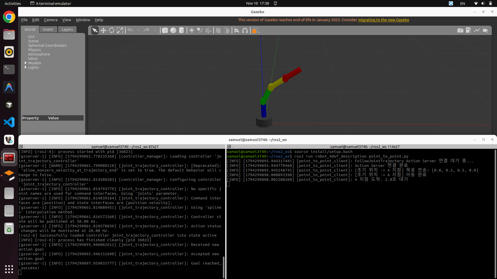
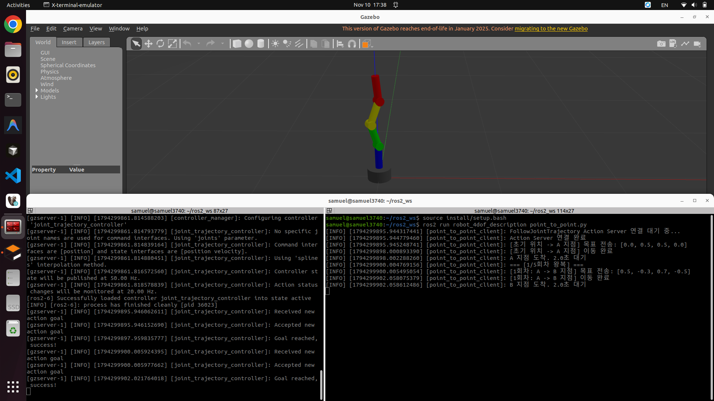

# 10주차 과제: 4DOF 로봇 Gazebo 통합 및 자동 왕복 제어 보고서

---

## 1. 9주차 개선사항

### 1.1 기존 4DOF 로봇 모델 재사용
- 9주차에 직접 설계한 `robot_4dof` 모델([urdf/robot_4dof.urdf.xacro](robot_4dof_description/urdf/robot_4dof.urdf.xacro))의 5개 링크(`base_link`, `link1`, `link2`, `link3`, `link4`)와 4개 회전 관절(`joint1`, `joint2`, `joint3`, `joint4`)의 구조, 회전축(`joint1`: Z축, `joint2`~`joint4`: Y축), 관절 제한값(`-1.5708 ~ +1.5708 rad`)을 변경 없이 그대로 재사용함.

### 1.2 Gazebo 통합을 위해 변경 및 추가한 사항
1. **월드 고정 조인트(`world` 링크 및 `world_joint`) 추가**:
   - Gazebo 물리 환경에서 로봇 베이스(`base_link`)가 중력 및 반작용 토크에 의해 흔들리거나 넘어지지 않도록 `world` 링크와 `base_link` 사이에 `fixed` 타입의 `world_joint`를 추가함.
2. **관절 물리 감쇠 속성(`<dynamics>`) 추가**:
   - 각 회전 관절(`joint1`~`joint4`)에 `<dynamics damping="0.1" friction="0.1"/>`을 추가하여 물리 시뮬레이션 시 과도한 진동을 억제하고 안정적인 궤적 추종이 이루어지도록 개선함.
3. **Gazebo 전용 색상(`<gazebo reference="...">`) 정의**:
   - URDF의 기본 `<material>` 태그는 RViz2에서만 표시되므로, Gazebo Classic 화면에서도 각 링크의 색상이 동일하게 구분되도록 `Gazebo/Grey`, `Gazebo/Blue`, `Gazebo/Green`, `Gazebo/Yellow`, `Gazebo/Red` 색상을 지정함.
4. **ROS2 Control 태그(`<ros2_control>`) 및 플러그인(`libgazebo_ros2_control.so`) 연동**:
   - `gazebo_ros2_control/GazeboSystem` 하드웨어 인터페이스와 컨트롤러 설정 파일(`config/ros2_controllers.yaml`)을 URDF/Xacro에 연결함.

---

## 2. ROS2 Control 구성

- **Hardware Interface**: `gazebo_ros2_control/GazeboSystem` (`<ros2_control name="GazeboSystem" type="system">`)
- **Command Interface**: `joint1`, `joint2`, `joint3`, `joint4` 각 관절에 대해 `position` 명령 인터페이스 설정 (`min: -1.5708`, `max: 1.5708`)
- **State Interface**: `joint1`, `joint2`, `joint3`, `joint4` 각 관절에 대해 `position`(초기값 `0.0`) 및 `velocity` 상태 인터페이스 설정
- **Controller Manager 및 컨트롤러 설정** ([config/ros2_controllers.yaml](robot_4dof_description/config/ros2_controllers.yaml)):
  - 제어 주기(`update_rate`): `100 Hz`
  - `joint_state_broadcaster` (`joint_state_broadcaster/JointStateBroadcaster`): 각 관절의 실시간 위치·속도 상태를 `/joint_states` 토픽으로 발행
  - `joint_trajectory_controller` (`joint_trajectory_controller/JointTrajectoryController`): `/joint_trajectory_controller/follow_joint_trajectory` Action Server를 통해 4개 관절의 목표 궤적을 보간 및 제어

---

## 3. Gazebo 통합

- **Launch 파일 구성** ([launch/gazebo_control.launch.py](robot_4dof_description/launch/gazebo_control.launch.py)):
  1. `gazebo_ros`의 `gazebo.launch.py`를 포함하여 Gazebo 시뮬레이터(`gzserver`, `gzclient`) 실행
  2. `xacro`로 변환된 `robot_description`과 `use_sim_time: True` 파라미터를 적용하여 `robot_state_publisher` 노드 실행
  3. `gazebo_ros`의 `spawn_entity.py` 노드를 통해 `/robot_description` 토픽으로부터 `robot_4dof` 모델을 Gazebo 월드에 스폰
  4. `RegisterEventHandler(OnProcessExit)`를 사용해 실행 순서를 보장:
     - `spawn_entity` 완료 후 → `joint_state_broadcaster` 로드 및 활성화(`active`)
     - `joint_state_broadcaster` 활성화 완료 후 → `joint_trajectory_controller` 로드 및 활성화(`active`)

---

## 4. Python Action Client

- **구현 파일**: [scripts/point_to_point.py](robot_4dof_description/scripts/point_to_point.py)
- **사용 Action 타입**: `control_msgs/action/FollowJointTrajectory`
- **Action Server 이름**: `/joint_trajectory_controller/follow_joint_trajectory`
- **주요 동작 구조**:
  1. `wait_for_server()`를 통해 컨트롤러의 Action Server가 활성화될 때까지 대기
  2. `JointTrajectoryPoint`에 4개 관절(`['joint1', 'joint2', 'joint3', 'joint4']`)의 목표 위치(`positions`), 목표 종료 속도(`velocities = [0.0]*4`), 도달 시간(`time_from_start = 2s`)을 설정하여 Goal 전송
  3. `send_goal_async()`로 Goal 수락 여부(`accepted`)를 확인하고, `get_result_async()`로 이전 궤적 도달이 완전히 끝난(`STATUS_SUCCEEDED`, `error_code == 0`) 후에만 다음 동작으로 진행

---

## 5. A-B 왕복 제어

- **목표 관절 위치 (관절 제한 `-1.5708 ~ +1.5708 rad` 내 검증 완료)**:
  - **A 지점**: `[0.0, 0.5, 0.5, 0.0]` (rad)
  - **B 지점**: `[0.5, -0.3, 0.7, -0.5]` (rad)
- **왕복 시퀀스**:
  - 초기 자세(`[0.0, 0.0, 0.0, 0.0]`) → **A 지점 이동** → **2초 대기**
  - **1~5회차 반복**: **(A → B 이동 → B에서 2초 대기 → B → A 이동 → A에서 2초 대기)** × 5회 = 총 10구간 왕복 이동 완료

---

## 6. 실행 방법 및 검증 결과

### 6.1 주요 실행 명령어

**터미널 1: 빌드 및 Gazebo + ROS2 Control 실행**
```bash
cd ~/ros2_ws
colcon build --symlink-install --packages-select robot_4dof_description
source install/setup.bash
ros2 launch robot_4dof_description gazebo_control.launch.py
```

**터미널 2: 컨트롤러 상태 확인 및 Python Action Client(5회 왕복) 실행**
```bash
cd ~/ros2_ws
source install/setup.bash
ros2 control list_controllers
ros2 run robot_4dof_description point_to_point.py
```

### 6.2 Gazebo 실행 화면
- **A 지점 (`[0.0, 0.5, 0.5, 0.0]`) 도달 화면**:
  
- **B 지점 (`[0.5, -0.3, 0.7, -0.5]`) 도달 화면**:
  
